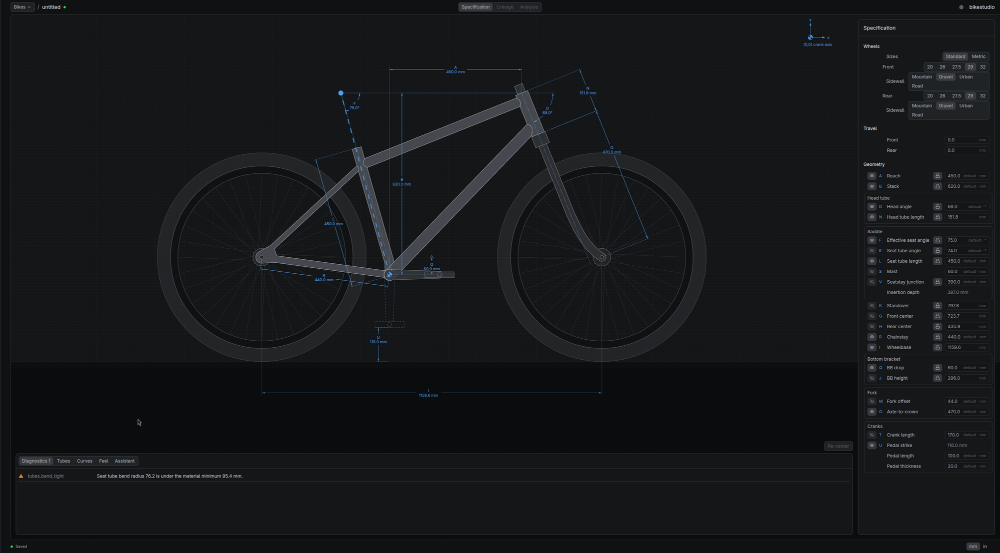
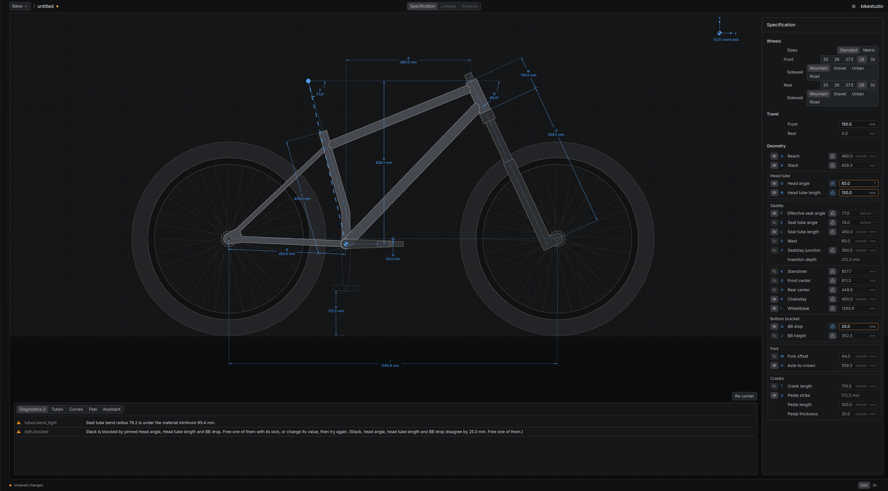
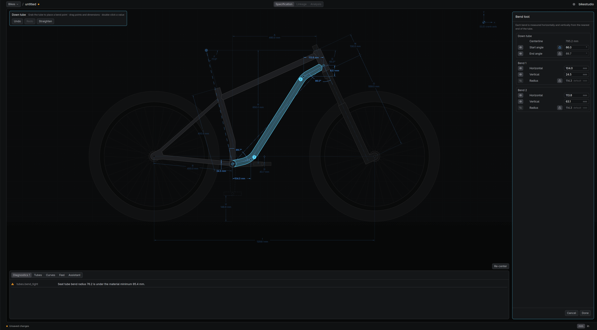

# BikeStudio community

BikeStudio is a free Linux and macOS app for designing rigid, hardtail and full suspension bike frames. It's free to use, but it isn't open source. This repo is where you can get in touch.

## Design

These screenshots are from the current build.

A new project opens with a default rigid frame. Geometry is set in the Specification pane on the right, and the side view redraws with labelled dimensions.

A design in progress. Edited values are locked, and the diagnostics panel explains when an edit conflicts with them.

The bend tool. Drag on a tube to place bends, then set each bend's position and radius on the drawing or in the panel.

## Get in touch

[Open an issue](https://github.com/courteccles/bikestudio-community/issues/new/choose) to:

- **Offer to contribute** code, component data or testing
- **Report a bug** or **suggest a feature**
- **Ask about a commercial licence**

Issues are public, so don't post anything private. If you need to share private details, say so in the issue and we'll arrange another way to talk.

## Licence

BikeStudio is free for individuals and for businesses with 4 or fewer people, under US$25K in gross annual revenue and under US$25K in funding raised, including commercial use. Businesses over any of those limits need a commercial licence. See [LICENSE](LICENSE) for the full terms.

Contributions are by invitation and need a signed contributor agreement.
